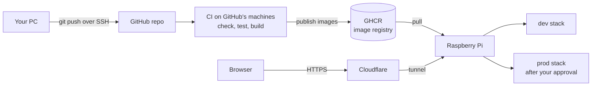

# Delivery pipeline

How a change gets from your PC to dev and prod, and the networking and access around it. Commands and procedures are in the [runbooks](runbooks/); the reasoning is in [ADR 0002](adr/0002-pi-deployment.md).

## The big picture



You push to `main`. GitHub tests the code and packages it into images. A runner on the Pi deploys those images to dev, and deploys the same images to prod once you approve.

Every connection to the Pi starts *from* the Pi, so the router has no open ports.

## Terms used below

| Term | Meaning |
| --- | --- |
| **Workflow / job / step** | A workflow is a YAML file in `.github/workflows/` that GitHub Actions runs. It contains jobs, and each job runs its steps on one machine (a **runner**). Independent jobs run in parallel. |
| **Container image** | A sealed package of an app plus everything it needs to run, built from a `Dockerfile`. **Multi-arch** means one image name holds builds for `amd64` (PCs) and `arm64` (the Pi). |
| **Image tag = commit SHA** | Images are named `ghcr.io/upendrasinghgusain/risky-business-{api,web}:<40-char commit SHA>`, so each one traces back to exact code, and old ones stay available for rollback. |
| **`GITHUB_TOKEN`** | A credential GitHub creates for **each job** when that job starts. It is limited to this repo and to the job's `permissions:` block, and expires when the job ends (at most after 24 hours). It is how a job talks to GitHub: fetching code, pulling or pushing images. |
| **GitHub environment** | A named deployment target (`dev`, `prod`) with rules a job must pass before it starts. GitHub records what was deployed to each. |
| **Compose project** | A set of containers, network and volumes that Docker Compose manages under one name (`riskybusiness-dev`, `riskybusiness-prod`). The name prefixes everything it creates, keeping the two environments apart on one Docker engine. |
| **Volume** | Docker-managed storage for the database files. It survives container restarts and redeploys. |

## The journey of a change

At each step: what happens, how each party proves who it is, and what was set up once beforehand.

### 1. You push to `main`

- **What happens:** you commit on your PC and run `git push`.
- **Access:** Git connects to GitHub over SSH and proves who you are with your private key `~/.ssh/id_ed25519`. GitHub checks the signature against the public half registered on your account. Branch protection on `main` (pull requests expected, no force-push, no deletion) lets you push directly because you are an admin.
- **Set up once:** the key pair, and the branch protection rules.

### 2. GitHub starts CI

- **What happens:** `ci.yml` is set to run on every push to `main` (and every pull request), so GitHub starts a run of it for this commit SHA.
- **Access:** none. This happens inside GitHub.

### 3. Check jobs run on GitHub's machines

- **What happens:** three jobs run in parallel, each on a fresh Linux VM that GitHub wipes afterwards:
  - **API:** format check, build, unit tests, and integration tests against a throwaway PostgreSQL container (Testcontainers).
  - **Web:** Prettier check, unit tests, production build.
  - **Images:** builds both images for both CPU types, to prove they build, then discards them.

  If any job fails, nothing is published or deployed.
- **Access:** each job's `GITHUB_TOKEN` has `contents: read`, used to fetch the code over HTTPS.
- **Set up once:** nothing. Hosted runners are free for public repos.

### 4. Images are published to GHCR

- **What happens:** the `publish` job runs only for pushes to `main`, and only after all three checks pass. It pushes the multi-arch images, tagged with the commit SHA, to GHCR (`ghcr.io`), GitHub's image registry.
- **Access:** this job's token is the only one with `packages: write`. It is used to log in to `ghcr.io` and push the images.
- **Set up once:** nothing manual. The first publish created the packages. An image label links each package to the repo, so the packages inherit the repo's visibility and access: they are public, so **anyone can pull** them, and only this repo's workflows and you can push.

This is **build once, promote the same artefact**. Nothing is rebuilt later, so prod runs exactly the images that dev tested.

### 5. GitHub decides whether to deploy to dev

- **What happens:** the `deploy-dev` job runs only if the repo variable `DEPLOY_ENABLED` is `true`, which is a kill switch for automatic deploys. It calls the reusable `deploy.yml` with environment `dev`. GitHub checks the `dev` environment's rule (deployments only from `main`), then queues the job for a runner labelled `[self-hosted, riskybusiness]`.
- **Access:** none. This is GitHub's own bookkeeping.
- **Set up once:** the `DEPLOY_ENABLED` variable, and the `dev` environment with its branch rule.

### 6. The Pi's runner picks up the job

- **What happens:** the runner is a GitHub program installed on the Pi as a service, running as the Linux user `github-runner`. It keeps a long-poll HTTPS request open to GitHub, which GitHub holds for about 50 seconds, asking "any jobs for me?". GitHub answers with this job, and only now creates the job's `GITHUB_TOKEN`, with `contents: read` and `packages: read`.
- **Access:** the runner proves it is runner `pi` for this repo with an RSA key saved on the Pi when it was registered. That key only lets it fetch jobs and report results; it cannot read code or packages. Access to the Pi itself needs no key: the runner is a local program, limited by what the `github-runner` user may do.
- **Set up once:** the runner was installed in `/home/github-runner/actions-runner` and registered to this repo with a one-hour registration token, which was exchanged for the RSA key. It was given the label `riskybusiness` and installed as a systemd service.

### 7. The deploy steps run on the Pi

- **What happens:** the steps in `deploy.yml`:
  1. **Checkout:** fetches the repo at that SHA over HTTPS, so the deploy scripts match the images. This is how the Pi gets code without an SSH key to GitHub.
  2. **Docker login:** logs in to `ghcr.io`. The images are public, so this login is not strictly needed today; it keeps deploys working if they become private.
  3. **Deploy:** runs `deploy/deploy.sh dev <sha>`.
- **Access:** steps 1 and 2 use the job token. The script runs as `github-runner`, which is in the `docker` group, so it can control Docker, and owns `/opt/riskybusiness`. Docker-group membership is effectively root on the Pi, so keep the Pi dedicated to this setup.
- **Set up once:** the `github-runner` user and its `docker` group membership, and `/opt/riskybusiness/{dev,prod,backups}` owned by that user.

### 8. `deploy.sh` updates the stack

- **What happens:**
  1. Checks the inputs: the environment is `dev` or `prod`, and the version is a full SHA.
  2. Installs the scripts to `/opt/riskybusiness/bin`, so cron and you can run them without GitHub, and installs `compose.yaml` to `/opt/riskybusiness/dev/`.
  3. Pulls the images for that SHA.
  4. Starts the Compose project `riskybusiness-dev` and waits until every container is healthy:
     - `db` (PostgreSQL) uses dev's volume. Its password comes from `/opt/riskybusiness/dev/.env`.
     - `api` (.NET) gets the same password from the same `.env`. It applies database migrations at startup, then reports healthy once it can reach the database.
     - `web` (nginx) serves the Angular app on `127.0.0.1:8181`.
  5. **Smoke test:** calls `http://127.0.0.1:8181/health/ready`, which goes web → API → database.
  6. On success, records the version in `version.env` and `deployments.log`, and prunes old images. On failure, prints the logs, fails the job and leaves the record on the last good version.
- **Access:** the containers talk over dev's private Docker network. Only `web` has a port on the Pi, and only on `127.0.0.1`, so nothing on your home network can reach the stack directly. The browser only talks to nginx, which forwards `/api` internally (same origin, so no CORS setup is needed).
- **Set up once:** each environment's `.env` was generated **on the Pi** with a random password, readable only by `github-runner`. The secrets never pass through Git or GitHub. The database adopted the password the first time its volume was created.
- **Also:** containers restart after a crash or reboot, and logs are capped at about 30 MB per container.

### 9. The dev job finishes

- **What happens:** Docker logs out of GHCR, checkout removes its stored token, the token expires, and the runner goes back to polling. GitHub records that dev now runs this SHA (see **Deployments** on the repo page).

### 10. Prod waits for your approval

- **What happens:** `deploy-prod` runs after `deploy-dev` and targets the `prod` environment, which requires a reviewer. The job pauses at "Waiting for review". No runner is assigned and no token exists yet.
- **Access:** you approve in the GitHub website, logged in as yourself, via **Review deployments → Approve and deploy**.
- **Set up once:** the `prod` environment with you as the required reviewer and the main-only branch rule. Required reviewers are free only on public repos, which is one reason the repo is public.

### 11. Prod is deployed

- **What happens:** the same as steps 6 to 9, with these differences:
  - `deploy.sh` first backs up prod with `pg_dump` (see [Backups](#backups)).
  - It uses prod's folder, `.env` and volume, and the project `riskybusiness-prod`.
  - The port is `127.0.0.1:8180`.
  - The images are the same SHA-tagged images dev tested.

### 12. A visitor uses the app

```text
Browser → https://risky-business.upendragusain.co.uk  (dev: risky-business-dev.…)
  → Cloudflare DNS: the name is a CNAME pointing at the tunnel
  → Cloudflare edge: holds the HTTPS certificate
  → Cloudflare Tunnel → cloudflared on the Pi
  → 127.0.0.1:8180 (prod) or :8181 (dev) → web (nginx) → api → db
```

- **What happens:** `cloudflared` keeps an outbound connection open to Cloudflare. Its ingress rules in `/etc/cloudflared/config.yml` map each hostname to a local port. The same tunnel, `pi-tunnel`, also serves `upendragusain.co.uk`.
- **Access:** visitors need nothing. `cloudflared` proves it is `pi-tunnel` with a credentials file on the Pi. Your home IP is never revealed.
- **Set up once:** the domain was already on Cloudflare and the tunnel already existed. Two ingress rules and two DNS CNAMEs were added. The free certificate covers one subdomain level, hence `risky-business-dev` rather than `dev.risky-business`.

### 13. Every night, separately

At 02:15, cron runs `/opt/riskybusiness/bin/backup.sh prod` as `github-runner`. GitHub is not involved.

## Who proves what, to whom

| Connection | Direction | Credential | Where it lives |
| --- | --- | --- | --- |
| You push code | PC → GitHub | SSH key `id_ed25519` | Your PC (public half on GitHub) |
| You administer the Pi | PC → Pi, home network only | SSH key `id_rsa` | Your PC (public half in the Pi's `authorized_keys`) |
| You manage the repo from the CLI | PC → GitHub | `gh` login token | Your PC (Windows credential store) |
| You approve prod | Browser → GitHub | Your GitHub login | Your browser |
| Runner fetches jobs | Pi → GitHub | Runner RSA key, from registration | `/home/github-runner/actions-runner` |
| Job fetches code and images | Runner → GitHub / GHCR | Per-job `GITHUB_TOKEN` | Only in memory during the job |
| Tunnel connects | Pi → Cloudflare | Tunnel credentials file | `/home/upendra/.cloudflared/` |
| API connects to the database | Inside a Docker network | Database password | `/opt/riskybusiness/<env>/.env` |
| Local development | Your PC only | `local-dev-only` password | In the repo; never used on the Pi |

No long-lived deploy secrets are stored in GitHub. The long-lived runner key is almost powerless, and the powerful job token exists only while a job runs. If the Pi is lost, remove the runner under **Settings → Actions → Runners** to revoke its key.

## Safeguards for a public repo with a self-hosted runner

- Deploy jobs run only for pushes to `main` or manual runs, never for pull requests.
- Workflows from outside contributors' pull requests need your approval before they run.
- Both environments accept deployments only from `main`, and prod also needs your approval.

## Rollback

Run the **Deploy** workflow by hand with an earlier commit SHA. Prod still needs approval. This changes the app only. Migrations only go forward, so each one must stay compatible with the previous app version; otherwise restore a backup.

## Backups

- `pg_dump` runs inside the db container and asks PostgreSQL for a consistent snapshot, so the volume is never copied while the database is in use. It runs before every prod deployment and nightly.
- Dumps are written to `/opt/riskybusiness/backups/<env>/`, first under a `.partial` name and then renamed, so a failed dump never looks valid. The newest 30 are kept.
- `restore.sh` loads a dump back with `pg_restore`. Practise by restoring a prod backup into dev.

## Where things are

| Thing | Location |
| --- | --- |
| Workflows | `.github/workflows/ci.yml`, `deploy.yml` |
| Stack and scripts | `deploy/` in the repo; installed to `/opt/riskybusiness/bin` on the Pi |
| Per-environment config and history | `/opt/riskybusiness/<env>/` (`.env`, `version.env`, `deployments.log`, `compose.yaml`) |
| Tunnel config | `/etc/cloudflared/config.yml` on the Pi |
| GitHub settings | Repo **Settings**: Branches, Environments, Actions → Runners, Secrets and variables |
| Procedures | [runbooks/pi-setup.md](runbooks/pi-setup.md), [runbooks/operations.md](runbooks/operations.md) |

## Not yet covered

- Dev is publicly reachable. Cloudflare Access can restrict it to you.
- Backups stay on the Pi's SD card. Add an off-device copy.
- No restore has been practised on the Pi yet.
- Passing CI is not yet required to merge into `main`. This only matters once you work through pull requests.
